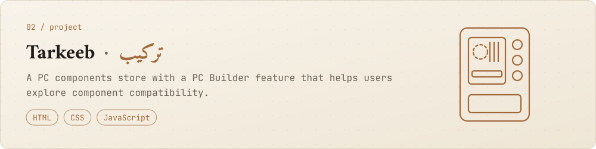
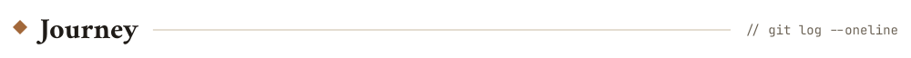

<em>Between the ink and the terminal, every idea waits for its first line.</em>
 
<strong>Software Engineering Student | Full-Stack Web Developer</strong>

 

  

  

<a href="https://midad-zcbt.onrender.com">Live demo</a> · <a href="https://github.com/I4zln/midad">Code</a>

<a href="https://raw.githack.com/I4zln/Tarkeeb-Build-Your-PC-Pathy/main/Tarkeeb%20%E2%80%94%20Build%20your%20PC.html">Live demo</a> · <a href="https://github.com/I4zln/Tarkeeb-Build-Your-PC-Pathy">Code</a>

  

  

