<em>Between the ink and the terminal, every idea waits for its first line.</em>

 

## 👋 About me

`$ whoami`

**Abdulaziz Al-Matrafi**, Software Engineering student
at Umm Al-Qura University, Makkah.

`$ cat about.txt`

I started programming quite naturally. I kept coming across beautiful websites
where people shared their ideas and turned what was in their heads into
something creative, each in their own way. So I asked myself, why not start
learning to code? I began experimenting with all kinds of things, just so my
ideas could reach people in my own way.

What I love most is the variety in creativity. Everyone has their own website
and their own visual identity, and that's the beauty of it: you can stand apart
from everyone else in your own way.

I'm working on growing in project management and becoming professional in
UI/UX. At the same time, I'm improving how I secure websites and how I make
them scalable, so they can handle a huge number of visitors.

`$ cat interests.txt`

- Full-stack web applications
- Software design
- Data structures
- System analysis

`$ cat looking-for.txt`

- Opportunities to contribute to software development projects
- Collaborating with technical teams
- Growing as a software engineer

 

 

## 🛠️ Tech stack

| Area | Tools |
|:--|:--|
| **Frontend** | `React.js` `JavaScript` `HTML` `CSS` |
| **Backend** | `Laravel` `PHP` `Java` |
| **Databases** | `SQL` `MySQL` `PostgreSQL` |
| **Tools** | `Git` `GitHub` `Docker` `VS Code` |

 

 

## 🚀 Projects

### MIDAD

An Arabic quotes and poetry library.

- Readers share the quotes that stayed with them
- They can save, comment and follow
- A Discover feed ranks quotes for each reader

**Stack:** `Laravel` `PostgreSQL` `Docker` 
**Links:** [Live demo](https://midad-zcbt.onrender.com) · [Code](https://github.com/I4zln/midad)

### Tarkeeb

A PC components store with a PC Builder feature.

- Helps users explore component compatibility
- Checks power and price as you build
- Available in English and Arabic

**Stack:** `HTML` `CSS` `JavaScript` 
**Links:** [Live demo](https://raw.githack.com/I4zln/Tarkeeb-Build-Your-PC-Pathy/main/Tarkeeb%20%E2%80%94%20Build%20your%20PC.html) · [Code](https://github.com/I4zln/Tarkeeb-Build-Your-PC-Pathy)

### Workshop Request System

Built for the IT Department at the Ministry of Education (Makkah Region).

- Replaced manual handling of maintenance requests
- Covers device and returned-item requests too
- One tracked workflow: submit, track, manage

**Stack:** `PHP` `MySQL`

### Sprout & Crumb

A website for a fictional vegan bakery.

- A menu and the bakery's story
- Preorders

**Stack:** `Web` `IBM Bob`

 

 

## 💼 Experience

<b>IT Trainee</b> · Ministry of Education, Makkah Region · Aug – Nov 2024

 

- Built a PHP and MySQL request system that replaced manual work
- Received a certificate of appreciation from the Head of IT

<b>Technical Support Trainee</b> · Makkah Municipality · Nov 2024 – Jan 2025

 

- 10-week cooperative training
- Networks and systems
- Cybersecurity
- Maintenance and user support

<b>AI Development Program</b> · Pathy × IBM eyouth

 

- Completed the program
- Built Tarkeeb with IBM Bob

<b>Event Organizer</b> · Tuwaiq Club

 

- Organized the club's launch ceremony

 

 

## 🎓 Education

| Degree | University | Period |
|:--|:--|:--|
| **B.Sc. in Software Engineering** | Umm Al-Qura University | 2025 – 2029 |
| **Diploma in Programming and Computer Science** | Umm Al-Qura University | 2022 – 2025 |

Member of **Tuwaiq Club**.

 

 

## 📫 Contact

| Platform | Link |
|:--|:--|
| **LinkedIn** | [abdulaziz-al-matrafi](https://www.linkedin.com/in/abdulaziz-al-matrafi-bbb238358/) |
| **X** | [@i4zl4](https://x.com/i4zl4) |
| **Instagram** | [@i1zln](https://www.instagram.com/i1zln/) |
| **Email** | [aziz4zl@outlook.com](mailto:aziz4zl@outlook.com) |

 

