

<picture>
<source media="(prefers-color-scheme: dark)" srcset="./assets/hero-dark.svg">
<source media="(prefers-color-scheme: light)" srcset="./assets/hero-light.svg">

</picture>

<em>Between the ink and the terminal, every idea waits for its first line.</em>

 

<picture>
<source media="(prefers-color-scheme: dark)" srcset="./assets/title-about-dark.svg">
<source media="(prefers-color-scheme: light)" srcset="./assets/title-about-light.svg">
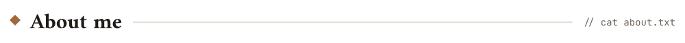
</picture>

<picture>
<source media="(prefers-color-scheme: dark)" srcset="./assets/terminal-dark.svg">
<source media="(prefers-color-scheme: light)" srcset="./assets/terminal-light.svg">
</picture>

 

I started programming quite naturally. I kept coming across beautiful websites
where people shared their ideas and turned what was in their heads into
something creative, each in their own way. So I asked myself, why not start
learning to code? I began experimenting with all kinds of things, just so my
ideas could reach people in my own way.

What I love most is the variety in creativity. Everyone has their own website
and their own visual identity, and that's the beauty of it: you can stand apart
from everyone else in your own way.

I'm working on growing in project management and becoming professional in
UI/UX. At the same time, I'm improving how I secure websites and how I make
them scalable, so they can handle a huge number of visitors.

 

<picture>
<source media="(prefers-color-scheme: dark)" srcset="./assets/divider-dark.svg">
<source media="(prefers-color-scheme: light)" srcset="./assets/divider-light.svg">

</picture>

 

<picture>
<source media="(prefers-color-scheme: dark)" srcset="./assets/title-experience-dark.svg">
<source media="(prefers-color-scheme: light)" srcset="./assets/title-experience-light.svg">
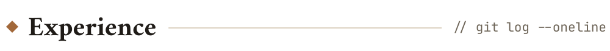
</picture>

<picture>
<source media="(prefers-color-scheme: dark)" srcset="./assets/journey-dark.svg">
<source media="(prefers-color-scheme: light)" srcset="./assets/journey-light.svg">
</picture>

 

<picture>
<source media="(prefers-color-scheme: dark)" srcset="./assets/role-it-dark.svg">
<source media="(prefers-color-scheme: light)" srcset="./assets/role-it-light.svg">
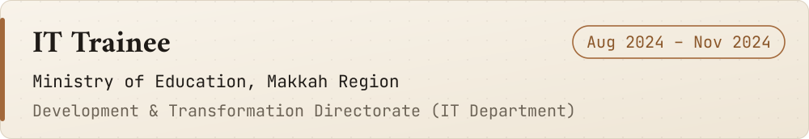
</picture>

<b>Highlights</b>

 

- Designed and developed a web-based workshop request management system for
  the IT Department, replacing manual handling of maintenance, device, and
  returned-item requests with a single tracked workflow.
- Built it with PHP and MySQL, including request submission, status tracking,
  and data management.
- Tested and refined the system with feedback from the department during
  development.
- Supported day-to-day IT operations: troubleshooting and maintaining computers
  and smart devices, and handling technical requests.
- Received a certificate of appreciation from the Head of the IT Department for
  outstanding effort during the training period.

 

<picture>
<source media="(prefers-color-scheme: dark)" srcset="./assets/role-support-dark.svg">
<source media="(prefers-color-scheme: light)" srcset="./assets/role-support-light.svg">
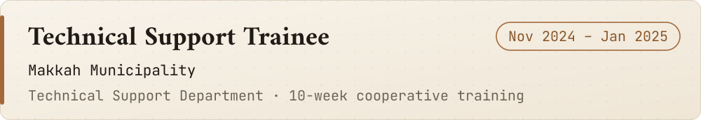
</picture>

<b>Highlights</b>

 

- Rotated across five areas: network support, systems support, cybersecurity
  support, maintenance, and end-user support.
- Provided first-line support to end users and helped resolve hardware,
  operating system, and network issues.
- Performed computer maintenance and troubleshooting as part of routine IT
  operations.
- Gained exposure to cybersecurity support tasks and IT service workflows.
- Completed the program with a certificate of completion.

 

**Also**

- **AI Development Program** · Pathy × IBM eyouth: completed the program and
  built Tarkeeb with IBM Bob.
- **Event Organizer** · Tuwaiq Club: organized the club's launch ceremony.

 

<picture>
<source media="(prefers-color-scheme: dark)" srcset="./assets/divider-dark.svg">
<source media="(prefers-color-scheme: light)" srcset="./assets/divider-light.svg">

</picture>

 

<picture>
<source media="(prefers-color-scheme: dark)" srcset="./assets/title-skills-dark.svg">
<source media="(prefers-color-scheme: light)" srcset="./assets/title-skills-light.svg">
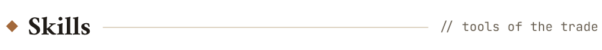
</picture>

<picture>
<source media="(prefers-color-scheme: dark)" srcset="./assets/skills-dark.svg">
<source media="(prefers-color-scheme: light)" srcset="./assets/skills-light.svg">
</picture>

 

| Category | Items |
|---|---|
| Languages | PHP, JavaScript, Java, SQL |
| Frameworks / Libraries | React.js, Laravel |
| Databases | MySQL |
| Areas | Full-stack web development, Software design, Data structures, System analysis, UI/UX (learning) |

 

<picture>
<source media="(prefers-color-scheme: dark)" srcset="./assets/divider-dark.svg">
<source media="(prefers-color-scheme: light)" srcset="./assets/divider-light.svg">

</picture>

 

<picture>
<source media="(prefers-color-scheme: dark)" srcset="./assets/title-projects-dark.svg">
<source media="(prefers-color-scheme: light)" srcset="./assets/title-projects-light.svg">
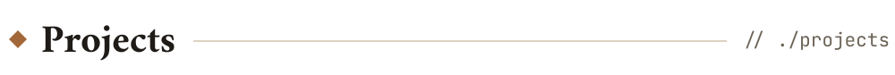
</picture>

<a href="https://midad-zcbt.onrender.com">
<picture>
<source media="(prefers-color-scheme: dark)" srcset="./assets/project-midad-dark.svg">
<source media="(prefers-color-scheme: light)" srcset="./assets/project-midad-light.svg">
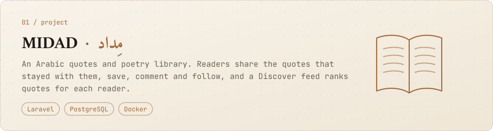
</picture>
</a>

 

An Arabic quotes and poetry library.

- Readers share the quotes that stayed with them
- They can save, comment and follow
- A Discover feed ranks quotes for each reader

**Links:** [Live demo](https://midad-zcbt.onrender.com) · [Code](https://github.com/I4zln/midad)

 

<a href="https://raw.githack.com/I4zln/Tarkeeb-Build-Your-PC-Pathy/main/Tarkeeb%20%E2%80%94%20Build%20your%20PC.html">
<picture>
<source media="(prefers-color-scheme: dark)" srcset="./assets/project-tarkeeb-dark.svg">
<source media="(prefers-color-scheme: light)" srcset="./assets/project-tarkeeb-light.svg">
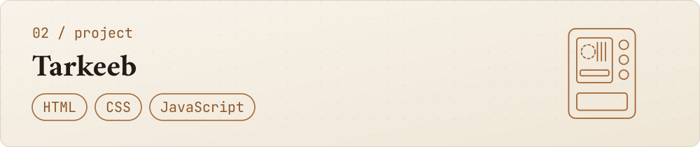
</picture>
</a>

 

A PC components store with a PC Builder feature.

- Helps users explore component compatibility
- Checks power and price as you build
- Available in English and Arabic

**Links:** [Live demo](https://raw.githack.com/I4zln/Tarkeeb-Build-Your-PC-Pathy/main/Tarkeeb%20%E2%80%94%20Build%20your%20PC.html) · [Code](https://github.com/I4zln/Tarkeeb-Build-Your-PC-Pathy)

 

<picture>
<source media="(prefers-color-scheme: dark)" srcset="./assets/project-workshop-dark.svg">
<source media="(prefers-color-scheme: light)" srcset="./assets/project-workshop-light.svg">
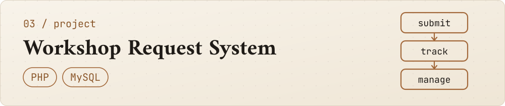
</picture>

 

Built for the IT Department at the Ministry of Education (Makkah Region).

- Replaced manual handling of maintenance requests
- Covers device and returned-item requests too
- One tracked workflow: submit, track, manage

 

<picture>
<source media="(prefers-color-scheme: dark)" srcset="./assets/project-sprout-dark.svg">
<source media="(prefers-color-scheme: light)" srcset="./assets/project-sprout-light.svg">
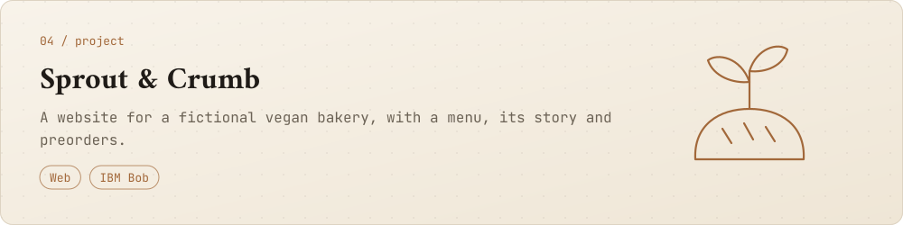
</picture>

 

A website for a fictional vegan bakery.

- A menu and the bakery's story
- Preorders

 

<picture>
<source media="(prefers-color-scheme: dark)" srcset="./assets/divider-dark.svg">
<source media="(prefers-color-scheme: light)" srcset="./assets/divider-light.svg">

</picture>

 

<picture>
<source media="(prefers-color-scheme: dark)" srcset="./assets/title-education-dark.svg">
<source media="(prefers-color-scheme: light)" srcset="./assets/title-education-light.svg">
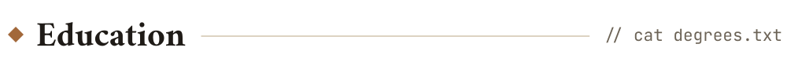
</picture>

| Degree | University | Period |
|:--|:--|:--|
| **B.Sc. in Software Engineering** | Umm Al-Qura University | 2025 – 2029 |
| **Diploma in Programming and Computer Science** | Umm Al-Qura University | 2022 – 2025 |

Member of **Tuwaiq Club**.

 

<picture>
<source media="(prefers-color-scheme: dark)" srcset="./assets/divider-dark.svg">
<source media="(prefers-color-scheme: light)" srcset="./assets/divider-light.svg">

</picture>

 

<picture>
<source media="(prefers-color-scheme: dark)" srcset="./assets/title-contact-dark.svg">
<source media="(prefers-color-scheme: light)" srcset="./assets/title-contact-light.svg">
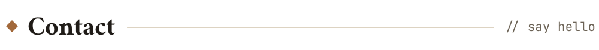
</picture>

<a href="https://www.linkedin.com/in/abdulaziz-al-matrafi-bbb238358/"><picture><source media="(prefers-color-scheme: dark)" srcset="./assets/contact-linkedin-dark.svg"><source media="(prefers-color-scheme: light)" srcset="./assets/contact-linkedin-light.svg"></picture></a>
<a href="https://x.com/i4zl4"><picture><source media="(prefers-color-scheme: dark)" srcset="./assets/contact-x-dark.svg"><source media="(prefers-color-scheme: light)" srcset="./assets/contact-x-light.svg"></picture></a>
<a href="https://www.instagram.com/i1zln/"><picture><source media="(prefers-color-scheme: dark)" srcset="./assets/contact-instagram-dark.svg"><source media="(prefers-color-scheme: light)" srcset="./assets/contact-instagram-light.svg"></picture></a>
<a href="mailto:aziz4zl@outlook.com"><picture><source media="(prefers-color-scheme: dark)" srcset="./assets/contact-email-dark.svg"><source media="(prefers-color-scheme: light)" srcset="./assets/contact-email-light.svg"></picture></a>

 

<picture>
<source media="(prefers-color-scheme: dark)" srcset="./assets/footer-dark.svg">
<source media="(prefers-color-scheme: light)" srcset="./assets/footer-light.svg">

</picture>
