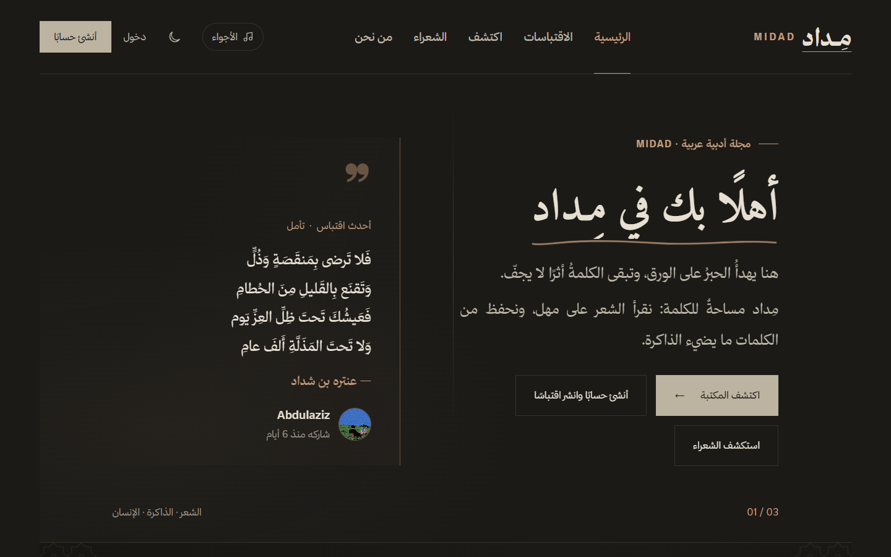
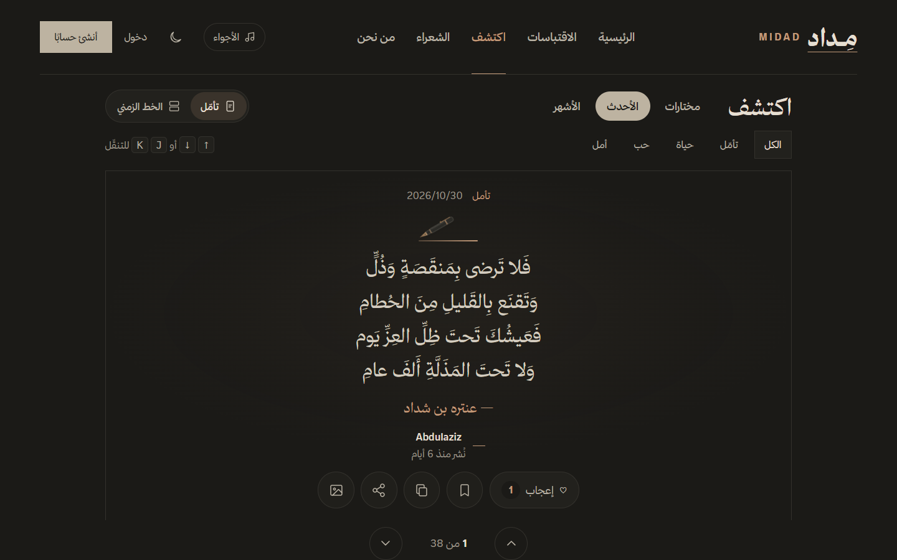
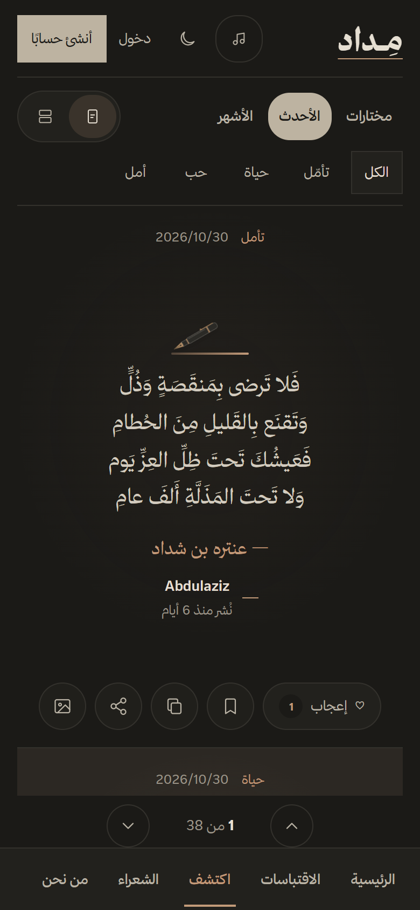

## 👋 About Me

<table>
<tr>
<td width="34%" align="center">

</td>
<td>

Hi, I'm **Abdulaziz** 👋 I graduated with a **diploma in Computer Science and Programming**, and I'm now a **Software Engineering student** at **Umm Al-Qura University** in Makkah.

I like building things people can actually use. During my training I fixed real computers, supported real users, and built a small system that replaced a manual process. That's what pulled me into full-stack web development.

- 💻 I build with **React.js, Laravel, PHP and SQL**
- 🧩 I enjoy turning a real problem into a working system
- 🌿 My latest project: **[مِداد · MIDAD](https://midad-zcbt.onrender.com)**, an Arabic quotes and poetry library, live now
- 📚 I'm currently studying data structures, OOP and software design

**What I do:**

- **Full-Stack Web Development:** building web apps from database to interface
- **Problem Solving:** troubleshooting and supporting real users, thanks to my IT support experience
- **Teamwork:** member of Tuwaiq Club, where I organized the launch ceremony

</td>
</tr>
</table>

## 🎓 Education

| Degree | University | Period | Details |
|:--|:--|:--|:--|
| **BSc in Software Engineering** | Umm Al-Qura University | 2025 – 2029 | Currently in second year. Data structures, OOP, requirements engineering, software design |
| **Diploma in Computer Science and Programming** ✅ *Graduated* | Umm Al-Qura University | 2022 – 2025 | Programming, databases, networks and web development with PHP, MySQL, Laravel and React.js |

## 💼 Experience

| Role | Organization | Highlights |
|:--|:--|:--|
| **IT Trainee** | Ministry of Education, Makkah | Built a PHP + MySQL workshop request system that replaced manual handling of maintenance and device requests. Received a certificate of appreciation from the Head of IT |
| **Technical Support Trainee** | Makkah Municipality | 10-week program across network, systems, cybersecurity, maintenance and user support |
| **AI Development Program** | Pathy × IBM eyouth | Completed the program and built the course project with IBM Bob |
| **Member / Event Organizer** | Tuwaiq Club | Event organization manager for the club's launch ceremony |

## ⭐ Featured Project: مِداد · MIDAD

**An Arabic quotes and poetry library where readers share the words that stayed with them.**

<table>
<tr>
<td width="77%"></td>
<td width="23%"></td>
</tr>
</table>

I built MIDAD from the database to the interface. Readers browse and search quotes, share their own, save what they love, comment, and follow readers with similar taste, all in a full Arabic right-to-left interface with light and dark themes.

- **Discover (اكتشف):** one quote per screen, ranked for each reader by freshness, appreciation and their favourite categories and authors
- **Admin panel:** search and moderate quotes, and a safe password-recovery flow that works even when email is unavailable
- **Built to be trusted:** CSRF protection, a strict Content-Security-Policy, rate limits and 140+ automated tests
- **Fast under load:** tested with 50 visitors at once, 95% of requests finished in under 150 ms with zero errors

## 🚀 Projects

| Project | Description | Stack |
|:--|:--|:--|
| **MIDAD · مِداد** ([live](https://midad-zcbt.onrender.com) · [code](https://github.com/I4zln/midad)) | Arabic quotes and poetry library with a personalised Discover feed, community features and an admin panel | `Laravel` `PostgreSQL` `Docker` |
| **[PC Parts Store + PC Builder](https://github.com/I4zln/Tarkeeb-Build-Your-PC-Pathy)** | Saudi PC components store with a builder that checks part compatibility and suggests upgrades | `React` `Laravel` `SQL` |
| **Workshop Request System** | Tracks maintenance, device and returned-item requests in one workflow | `PHP` `MySQL` |
| **Sprout & Crumb** | Website for a fictional vegan bakery with menu, story and preorders | `Web` `IBM Bob` |

## 🛠️ Tech Stack

Hover over an icon to see its name, and click it to open the official site

 

<table>
<tr>
<td align="center" width="18%"><h3>🎨 Frontend</h3></td>
<td width="42%">

&nbsp;
&nbsp;
&nbsp;

</td>
<td>Responsive pages and component-based interfaces</td>
</tr>
<tr>
<td align="center"><h3>⚙️ Backend</h3></td>
<td>

&nbsp;
&nbsp;

</td>
<td>Server-side logic with PHP and Laravel, plus Java for my university coursework</td>
</tr>
<tr>
<td align="center"><h3>🗄️ Database</h3></td>
<td>

&nbsp;

</td>
<td>Designing tables, keys and indexes, and writing SQL queries</td>
</tr>
<tr>
<td align="center"><h3>🧰 Tools</h3></td>
<td>

&nbsp;
&nbsp;
&nbsp;

</td>
<td>Version control, containers and deploying to the web</td>
</tr>
</table>

## 📊 GitHub Stats

## 📫 Contact

I'm open to internships, collaborations and project ideas. Feel free to reach out.

